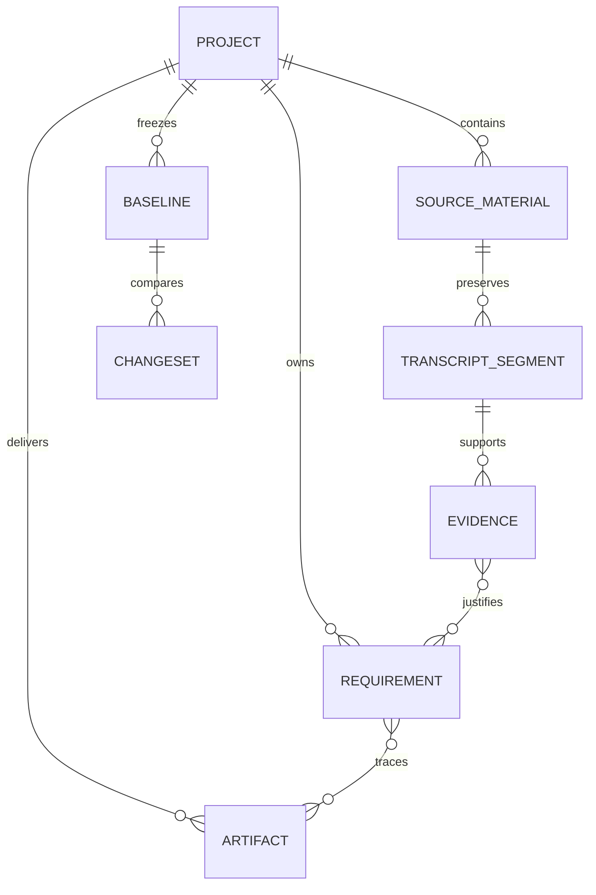

# 共享项目数据模型

本项目用普通文件持久化，不启动数据库服务。`schemas/` 是可加载的 JSON Schema，`scripts/project_lib.py` 提供通用读取、原子写入和 Schema 子集校验，`validate_project.py` 负责跨文件关系。

## 关联图

## 文件职责

| 文件 | 唯一事实 | 不允许 |
|---|---|---|
| `project.json` | 项目身份、当前版本、当前 Baseline、共享画像 | 复制整份逐字稿或需求历史 |
| `sources/sources.jsonl` | 原始材料身份、SHA-256、授权和处理状态 | 用生成文本覆盖原文件 |
| `sources/transcript.jsonl` | 原文 Segment、匿名说话人和时间定位 | 把推断写回 `original_text` |
| `evidence/evidence.jsonl` | 可定位的原话引用和 E0-E3 | 引用不存在的 Segment |
| `requirements/requirements.json` | 当前工作态 REQ 与锁定信息 | 自动重排已有 REQ ID |
| `models/business-model.json` | 角色、流程、实体、规则、状态和依赖 | 为所有项目强制生成 ER 图 |
| `baselines/v*.json` | 人工确认时的完整 REQ 快照 | 覆盖或静默改写历史 Baseline |
| `changesets/*.json` | 新旧值、来源、冲突和影响范围 | 未审批直接成为新 Baseline |
| `artifacts/` | 方案、PRD、工作台和原型 | 用未确认需求生成客户原型 |
| `manifest.json` | 实际文件、版本、依赖和校验结果 | 把未生成文件登记为 success |

## 关键规则

1. `source_id` 标识一份材料，`segment_id` 标识材料中的一段，`evidence_id` 标识一次证据引用，三者不可复用同一概念。
2. `E1=explicit`、`E2=inferred`、`E3=suggested`、`E0=unknown/conflict`。旧 `evidence_type` 只作迁移输入，旧 `review_status` 映射到独立 `status`。
3. REQ 在项目内稳定。新需求使用当前最大序号加一，重跑按 ID 合并，不按标题重新编号。
4. `locked_by_human=true` 禁止自动修改整条 REQ；`locked_fields` 只禁止列出的字段。人工修改和解锁必须追加到 `reviews/review.json` 的 `records`。
5. Requirement 的 `status`、证据等级、Source 处理状态、Artifact 生成/评审状态、Baseline 状态和 ChangeSet 评审状态互不混用。
6. 自动合并前执行锁定检查；冲突进入 ChangeSet，保留旧值，不静默选择新值。
7. 原型只读取当前已冻结 Baseline 中 `confirmed` 的需求，并关联相同验收标准。

## Schema 校验范围

辅助脚本使用 Python 标准库实现本项目 Schema 所需的常用子集：`type`、`required`、`properties`、`items`、`enum`、`pattern`、`minLength`、`minItems`、`minimum`、`maximum`、`uniqueItems` 和本地 `$ref`。完整 Draft 2020-12 关键字并非全部实现；有 `jsonschema` 的环境可进一步执行完整校验。
