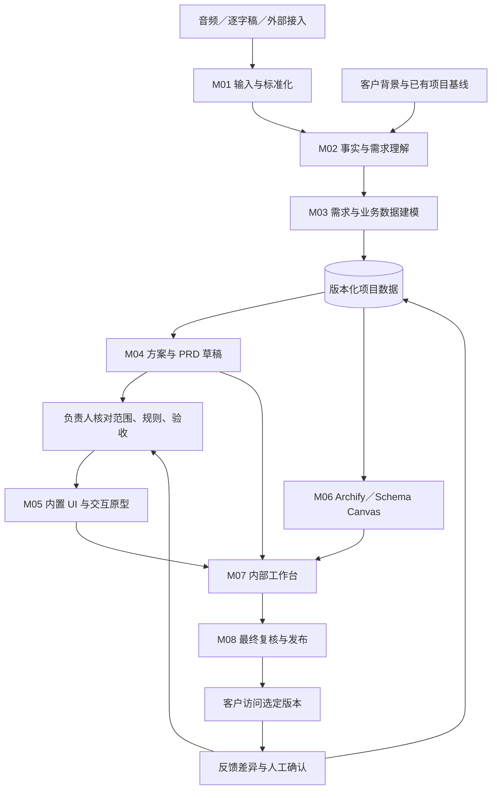

# 整体框架

2026-11-17 的设计基线。当前已实现文本标准化、依赖定位、Skill 指令与内置模板规范。以下整体流水线为待联调架构。

## 执行分层

| 层 | 职责 | 对应模块 |
| --- | --- | --- |
| 输入层 | 材料接收、转写适配、来源标准化与后台触发 | M01 |
| 理解层 | 前情关联、事实与需求提取、画像与业务模型 | M02、M03 |
| 生成层 | 方案、PRD、图示、原型与工作台 | M04—M07 |
| 跨阶段控制 | 人工确认、基线、锁定、任务恢复与发布范围 | 主 Skill 编排、M08 |

主 Skill 组织调用顺序，外部宿主或 PC 运行器负责实际任务运行。后台接收后的预处理先整理可用信息，将未确定关联与冲突留给负责人核对。

## 工程位置

- product-requirements/SKILL.md 为编排入口，references/ 保存执行规则和数据约定。
- assets/ 保存 PRD 模板与通用 UI 样式，scripts/ 保存当前实际工具。
- Archify 与 Schema Canvas 由 integrations.json 和依赖定位工具接入，实际实现保存在配置的位置。
- 项目结果建议写入 runs/项目标识/版本/，输入、草稿和确认基线分别引用版本。

正式技术实现随模块增补，已有文件承担的行为见 [实际功能](../features/README.md)。候选交接见 [模块拆分](modules.md)和[数据契约](contracts.md)。

## 关键取舍

- 首版使用版本化文件交接，沿用现有 JSON／JSONL／Markdown／HTML 产物约定，数据服务和持久任务系统在实际需要时评估。
- 生成与评审状态分别记录，来源证据与人工决定分别保存。
- 原型与发布依赖明确的确认版本，后续输入使相关成果进入待复核状态。
- 依赖调用实际成功后记录成果，缺失依赖时返回具体环节与恢复方式。
