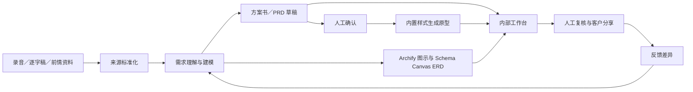

# 产品需求落地 Skill 开发文档

2026-11-17 的团队开发入口。这里集中维护整体流程、模块交接、三人分工、实施顺序与验收方式，详细字段和设计规则通过文末链接读取。

## 目标与首版链路

面向 PM／FDE，将客户会议与前情资料转成带依据的需求，完成建模后生成方案书和 PRD。负责人确认后生成交互原型，将图示、数据模型与成果汇入内部工作台，复核选定版本后分享给客户。



先完成一份脱敏逐字稿到可评审成果的闭环，再接入 ASR、录音豆和 PC 后台触发。后台先列出需求、疑问和框架，资料关联不明或字段缺失时保留待确认。

## 当前基础

| 项目 | 已有内容 | 后续工作 |
| --- | --- | --- |
| 主 Skill | 编排指令、四条原则、需求建模与输出约定 | 在选定宿主验证真实执行 |
| 文本导入 | TXT、Markdown、SRT、VTT 转 sources.jsonl | 统一其他输入与 ASR 适配 |
| 依赖接入 | Archify 固定提交、自有 Schema Canvas 开发副本和入口定位 | 实际项目数据到图示输入的适配 |
| 文档与界面 | PRD 模板、内置 UI 规范与 CSS、workbench 参考副本 | 方案、PRD、原型和工作台生成 |
| 评审与版本 | 字段锁定、差异与双阶段确认设计 | 结果持久化、增量修订和发布验证 |

文本导入已检查时间定位、重复运行 ID、普通文本与失败保留旧结果。依赖定位检查证明本地入口存在，端到端生成、ASR、硬件和部署仍待实现或联调。

## 工程入口

| 位置 | 开发用途 |
| --- | --- |
| [主 Skill](../product-requirements/SKILL.md) | 输入路由、阶段顺序、人工确认与输出要求 |
| [包内 references](../product-requirements/references/workflow.md) | 需求、输入、能力接入、UI 与文件合同 |
| [PRD 模板](../product-requirements/assets/prd-template.md)、[UI 样式](../product-requirements/assets/ui.css) | 实际生成使用的模板与样式 |
| product-requirements/scripts/ | 文本导入、依赖定位和后续实际工具 |
| [参考索引](references/README.md) | Archify、Schema Canvas 与 workbench 的来源和采用范围 |
| [workbench 副本](references/partrace-workbench/workbench.html) | 直接修改和验证布局、内容组织与交互 |

主 Skill 包为 product-requirements/，Archify 和 Schema Canvas 的开发副本位于工程旁 skill-dependencies/。运行结果写入仓库根目录 runs/，录音保存在 recordings/ 或用户选择的位置。

## 模块与三人分工

以下为职责建议，具体成员姓名和 GitHub 账号待团队对应。

| 模块 | 输入 → 输出 | 主责建议 | 实现重点 |
| --- | --- | --- | --- |
| M01 输入与标准化 | 音频／文本 → 来源片段与任务阶段 | B | ASR、时间定位、传输完成判断、去重和恢复 |
| M02 需求理解 | 来源与前情 → 画像、REQ 卡、疑问与冲突 | A | 原话追溯、事实与推断标识、稳定需求 ID |
| M03 业务建模 | 需求与现有流程 → 实体、字段、关系、状态与页面任务 | A | 依据、约束、候选模型与真实数据库关系 |
| M04 文档生成 | 项目数据与模板 → 方案书／PRD 草稿 | A | 规则、异常、逐条验收和人工核对入口 |
| M05 原型生成 | 已确认需求与页面规范 → 可交互原型 | C | 内置 UI、产品类型、样式依据与核心任务 |
| M06 图示与 ERD | 同版本流程／模型 → Archify 图示与 Schema Canvas 页面 | C，B 协作 | 输入适配、依赖失败、生成结果及来源版本 |
| M07 工作台 | 真实成果与评审数据 → 内部 HTML 工作台 | C | 侧栏、预览、来源、疑问、版本与有效入口 |
| M08 评审与发布 | 人工决定／客户反馈 → 差异、新基线与发布记录 | A，C 协作 | 锁定保护、双阶段确认、客户可见范围 |

B 先交付 sources.jsonl，A 形成需求、业务模型、方案和 PRD。负责人确认范围与规则后，C 基于同一版本生成原型和工作台，A 汇总复核决定，C 执行选定版本的发布。

## 共同数据与产物

| 文件 | 交接内容 |
| --- | --- |
| sources.jsonl | 原文、材料标识、稳定片段 ID、段落或时间定位 |
| project.json | 前情、八要素、REQ 卡、业务模型、页面规范、样式依据和版本 |
| proposal.md、prd.md | 对应项目版本的方案书与需求定义 |
| review.json | 问题、冲突、差异、影响、确认人及确认版本 |
| prototype/index.html | 基于确认版本的核心流程原型 |
| diagrams/*.html、data-model/index.html | 架构／流程图和交互式数据模型 |
| workbench/index.html | 内部成果汇总与评审入口 |
| manifest.json | 真实文件、生成状态、评审状态、依赖版本、检查与发布结果 |

字段细节以 [输出合同](../product-requirements/references/output-contract.md) 为准，跨模块调整先核对生产者与消费者。人工确认绑定具体版本，需求或规则变化后重新检查受影响成果。

## 开发顺序与验收出口

| 阶段 | 做什么 | 怎样判断可以交接 |
| --- | --- | --- |
| 1．统一样本与合同 | 选择一份获准使用的脱敏逐字稿，列出人工核对基准 | 片段可定位，关键需求、未知与冲突有明确依据 |
| 2．需求与文档 | 生成 project.json、方案、PRD 和疑问清单 | REQ ID 稳定，引用存在，规则与异常可评审，缺失字段明确 |
| 3．原型与工作台 | 人工确认后生成核心任务，接入图示和模型 | 主流程能操作，页面对应需求，工作台入口和资源有效 |
| 4．反馈修订 | 加入一条新增或变更，并锁定一项人工修改 | 显示旧值、新值与影响，锁定项保留，相关成果形成新版本 |
| 5．语音与后台 | 同一样本接入 ASR，再接 PC 文件触发 | 记录转写质量与费用，重复接收结果一致，失败能定位和恢复 |
| 6．分享与提交 | 人工复核客户版本，在比赛宿主验证并准备发布包 | 发布内容与选择一致，实际链接可访问，包体积、文件数和许可经核对 |

各阶段保存实际输入、源码版本、运行环境、结果与限制。记录人工核对时间及 ASR／模型／实际托管费用，目标阈值根据样本基线确定。

## 本地开发起步

在仓库根目录执行。

```bash
git switch dev/workbench-foundation
python3 product-requirements/scripts/normalize_transcript.py --help
python3 product-requirements/scripts/resolve_capability.py archify
python3 product-requirements/scripts/resolve_capability.py schema-canvas
```

准备一份逐字稿后执行以下导入命令，meeting.srt 为实际文件路径。

```bash
python3 product-requirements/scripts/normalize_transcript.py \
  --input meeting.srt \
  --project-id demo \
  --output runs/demo/sources.jsonl
```

依赖位于其他位置时使用 ARCHIFY_SKILL_DIR 和 SCHEMA_CANVAS_SKILL_DIR，分别指向包含 SKILL.md 的目录。实际设备型号、ASR 服务、无人值守宿主和托管服务需要在对应模块开发时确认并验证。

## 协作与修改

- 从开发基线建立功能分支，按模块提交 PR，说明变更、影响消费者与实际验证。
- 需求和数据字段调整同步输出合同，页面模式调整同步内置 UI 规范。
- 客户材料、生成项目和服务密钥保存在本地运行位置，仓库演示使用获准的脱敏样本。
- workbench 参考目录保留原项目素材，运行包按实际需要选择文件并核对许可与赛规。
- 开发后将完成事实与失败限制更新到对应实现记录，模块设计与实际验收分别维护。

详细备查见 [架构](architecture/README.md)、[数据契约](architecture/contracts.md)、[UI 规范](../product-requirements/references/ui-design.md)和[实际能力](features/README.md)。
